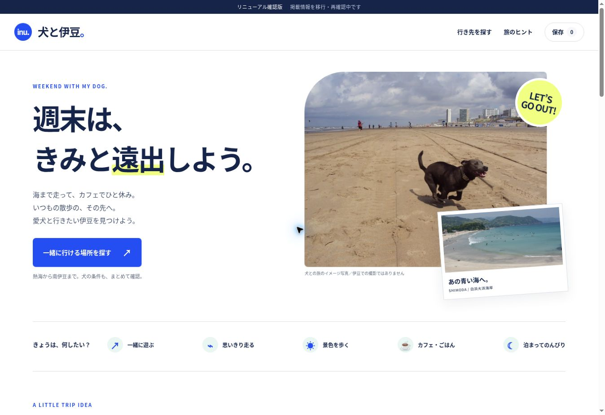
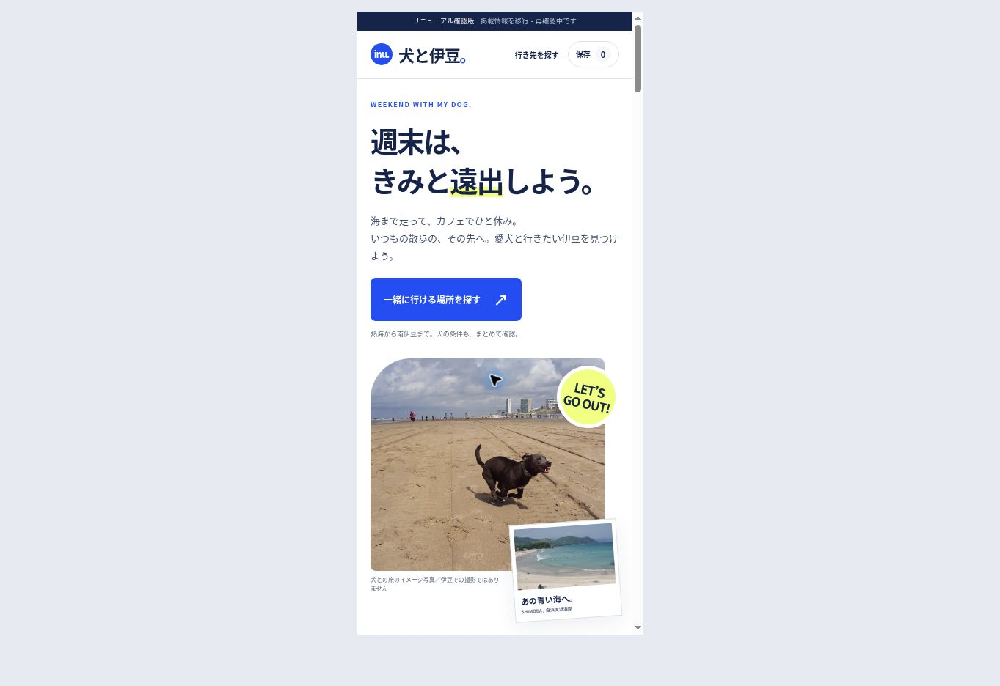

## 公開用構成の確認（10/25、追加）

- トップは既存URLを維持。画像・CSS・JSと施設データがrenewal配下から読み込める構成で確認。
- 検索対象53件（確認元URLのあるもの、現在の同伴条件が未確認の1件を除外）。熱海5件、熱海＋今回再確認0件、全エリア＋今回再確認6件。ハナカフェの詳細を開く動作を確認。
- 計測のテスト5件は再度成功。公開先での実受信は別途確認が必要。
- 広告は既存A8リンクを維持。リンク先到達は確認済み。契約と成果は未確認。

以下は確認版の初回検証記録。

# 2026/10/25 検証記録

## 確認した状態

- 初期一覧：62件。既存9地域60件＋追加3件のうち、同伴条件が現在未確認の1件を除外。
- 熱海指定：5件。食事指定を重ねると3件。
- 今回再確認した情報だけ：6件。
- 存在しない名称の検索：0件と条件解除ボタンを表示。解除で62件に戻る。
- ハナカフェの詳細：料金例、7:00〜19:00、無料駐車場10台、テラス限定、確認元リンクを表示。
- 施設を保存：保存1件を表示し、再読み込み後も保持。解除で0件に戻る。
- スマホ用390pxフレーム（実コンテンツ幅375px）：横方向のはみ出しなし。地域・食事の検索と施設詳細を開く操作を確認。
- 地図：Leaflet初期化とマーカー生成を確認。検証環境では背景タイルに403を示す画像が表示される場合があり、背景地図の正常表示は未検証。通信エラー時の処理と、常設の「地図が表示されない場合は一覧へ」を実装。常設ボタンで一覧へ戻れることを確認。
- A8：既存リンクをHEADで1回確認。HTTP 200、じゃらんトップへ到達。犬宿や指定地域への直リンクではないため、画面にもその旨を明記。
- HTML内の参照ID・ローカル画像・CSS・JSの存在、施設IDの一意性、元データの座標範囲をチェック。
- `node --check app.js` 成功。
- 計測テスト5件すべて成功。確認版の送信禁止、同意前・拒否後、所有者除外、電波マップ除外、不要な個人入力の送信防止を確認。

## 未完了を完了扱いしない

- 新イベントのGA4実受信は未確認。確認版は送信しない。
- A8の提携継続・個別の掲載条件・予約成果・承認報酬は管理画面未照合。
- WindsorはTrial。試用後の取得経路は未確定。
- 既存情報の全面再確認、残る施設の料金・営業時間・画像充実、既存URLへの展開は未完了。
- 現在の公開版は変更していない。GSCの認証、同名GA4プロパティ、電波マップを削除・変更していない。

## 画面

